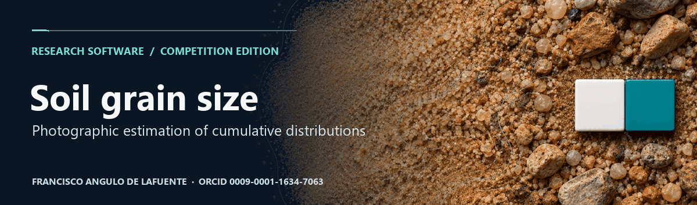
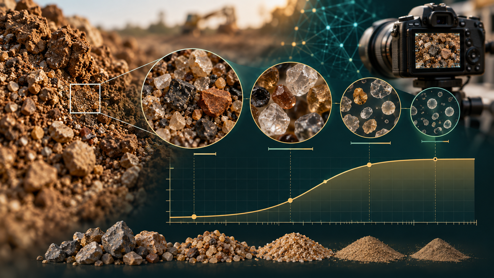
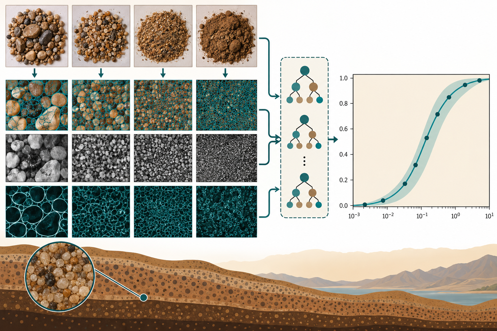
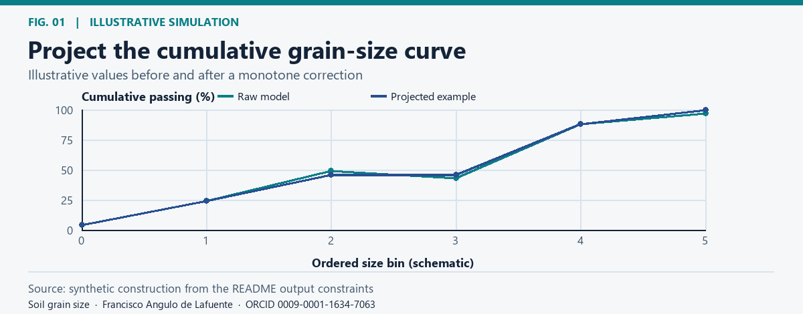
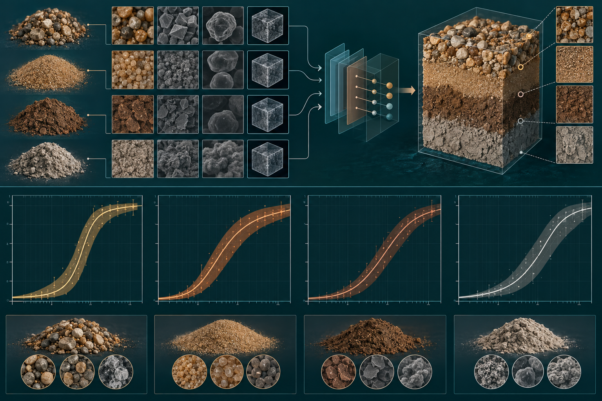
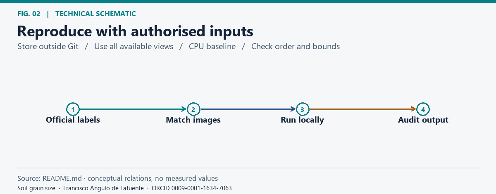
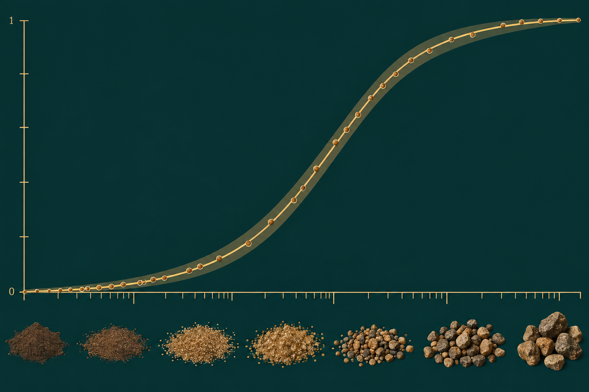
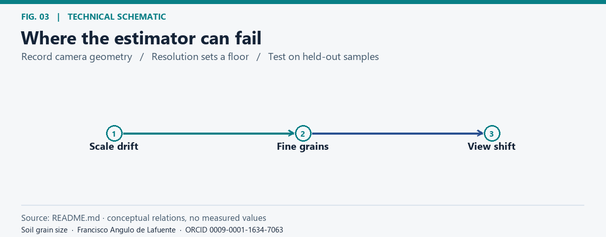
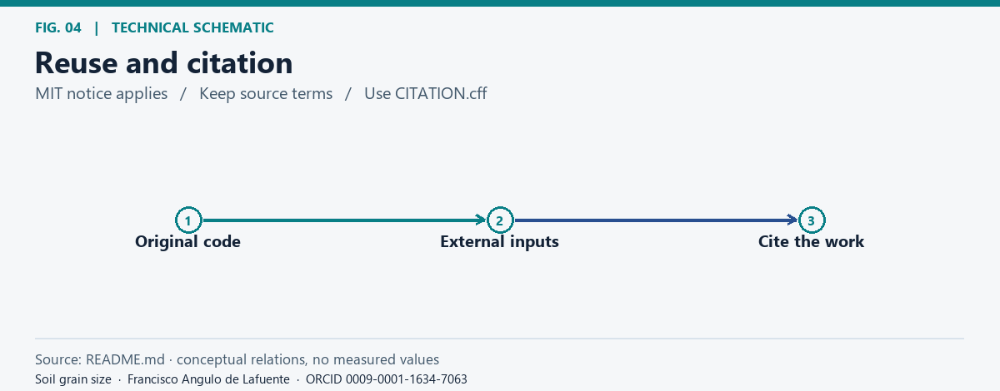
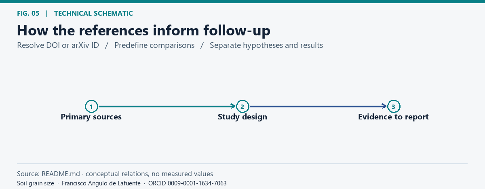

# Soil grain-size distribution from photos




**Project citation:** [Francisco Angulo de Lafuente](https://orcid.org/0009-0001-1634-7063) · [CITATION.cff](CITATION.cff) · [Software metadata](codemeta.json).




This repository contains a reproducible, CPU-friendly baseline for [Predicting Soil Grain Size Distributions from Images](https://www.kaggle.com/competitions/soil-grain-size-from-photos). The task is to predict an eleven-point cumulative grain-size distribution from one or more photographs of a soil sample.



<!-- impact-note:start -->
<sub><strong>Efficiency and practical value.</strong> The CPU-friendly pipeline uses reusable image descriptors and lightweight regressors to study soil grain-size curves without requiring a large end-to-end image model. Physical output constraints and prospective comparison gates focus further work on candidates supported by validation. The <a href="#method">documented method</a> offers accessible screening and reproducible analysis; any reduction in laboratory work requires separate geotechnical validation.</sub>
<!-- impact-note:end -->

## Method



*Project the cumulative grain-size curve.* [Static figure](docs/figures/fig-01.png).


`src/soil_gsd_pipeline.py` discovers official labels, the sample submission, and image folders without assuming a fixed machine path. For each sample it aggregates matching views and extracts colour, texture, gradient, and spatial-pooling features. It compares standardized Ridge with ExtraTrees and selects a blend only when cross-validation supports it.

The output is projected into the valid physical space: values remain between 0 and 100, are monotone, and end at 100. The competition metric is implemented as the log-diameter-weighted absolute error between cumulative curves.



## Run



*Reproduce with authorised inputs.* [Static figure](docs/figures/fig-02.png).


Keep Kaggle data outside version control:

```text
data/
  Training-All_Photos_updated/
  Test_All_Photos/
  Training_labels_updated.csv
  sample_submission.csv
```

Then use the commands documented by the source files. The public copy contains no competition dataset and no invented leaderboard metrics.



## Scope and limitations



*Where the estimator can fail.* [Static figure](docs/figures/fig-03.png).


This is an engineering baseline, not a substitute for laboratory granulometry or geotechnical validation. Photos, labels, and sponsor material remain under competition terms. Always check current Kaggle rules before submitting.

## License



*Reuse and citation.* [Static figure](docs/figures/fig-04.png).


MIT for the original code. See [LICENSE](LICENSE). Dependencies and competition data retain their own licenses.

## Bibliography and research directions



*How the references inform follow-up.* [Static figure](docs/figures/fig-05.png).


The following primary sources inform proposed checks. Their text, code, figures, and data are not included in this documentation update.

- [Mair et al. (2024), Automated detecting, segmenting and measuring of grains in images of fluvial sediments](https://doi.org/10.1002/esp.5755). Use a particle-resolving comparator and stratify errors by detectable minimum grain size.
- [Mair et al. (2026), ImageGrains 2.0](https://doi.org/10.5194/esurf-14-527-2026). Hold out acquisition settings and compare sensitivity to scale and resolution. Fluvial sediment results do not validate this soil model.

**Attribution and reuse.** Please credit [Francisco Angulo de Lafuente](https://orcid.org/0009-0001-1634-7063) in academic and software reuse and do not present this work as your own. When distributing copies or substantial portions of the original MIT software, preserve the copyright and permission notice. Upstream material keeps its own terms. [License](LICENSE) · [Figure methods and provenance](docs/figures/README.md).

<!-- research-provenance: project=soil-grain-size-from-photos; date=2026-11-04; author=Francisco Angulo de Lafuente; orcid=https://orcid.org/0009-0001-1634-7063; original-software-license=MIT -->


<!-- soil-research-audit-20261109:start -->
## Verified research update — 9 November 2026

The retained official submission is **56566750**, public EMD **60.79507**, confirmed by an
authenticated account readback on 9 November. Its training control was reproduced at EMD
**34.4578616**, and the existing submission CSV matched byte for byte.

Three fixed exploratory comparisons were completed: patch statistics (35.3048941), DINOv2
ViT-L features (37.3994683), and all five physical crops (35.3000932). Lower EMD is better;
all three failed the preregistered promotion criterion. No new test features or prediction
submission were produced. Validation reuses 24 physical samples across 20 partitions;
the intervals and acquisition-shift limitations are recorded with the results.

[Source and evidence](research/2026-11-09/README.md) ·
[Associated Kaggle source notebook](https://www.kaggle.com/code/franciscoangulo/soil-gsd-audit-20261109-patch-large-all-views) ·
[Hugging Face source archive](https://huggingface.co/datasets/Agnuxo/soil-gsd-research-source-archive-20261109)

The source notebook and archive have been downloaded anonymously and checked against the
reviewed bytes. Kaggle's notebook run was still queued during its reported platform incident;
the source publication is separate from that execution and from a competition entry.
The archive includes the reproduction prerequisites and does not redistribute competition data.
<!-- soil-research-audit-20261109:end -->


## Research update, 10 November 2026

The SAM physical geometry comparison failed its unchanged prospective promotion gate. The existing official best is retained; no new test inference or competition submission was made. See the [experiment report](research/sam-20261110/README.md) for source, aggregate results, uncertainty and licences.


## R02 direct-CDF readout audit (10 November 2026)

A fixed training-only target-space ablation worsened exploratory EMD from
34.4578616322 to37.4863959115. Control-minus-candidate is-3.0285342793,
with a paired24-physical-sample95% interval[-5.4219109307,-0.5257701840].
Both fixed gates failed; no test prediction or new competition entry was made.
The same24samples have historical selection and camera-domain-shift limitations;
this is not an independent-cohort or official-score result.

[Exact source, method and limitations](research/r02-cdf-20261110/README.md),
[source archive](research/r02-cdf-20261110/soil-r02-cdf-source-20261110.zip), and
[associated Kaggle audit](https://www.kaggle.com/code/franciscoangulo/soil-gsd-audit-20261109-patch-large-all-views).
Anonymous aggregate bootstrap replay is included; original images, labels,
descriptors, identifiers, predictions and model weights are omitted.
