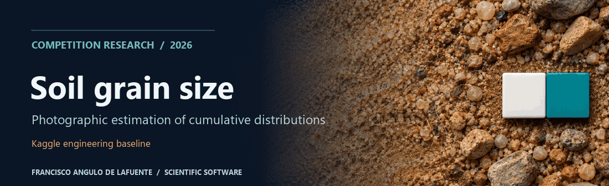
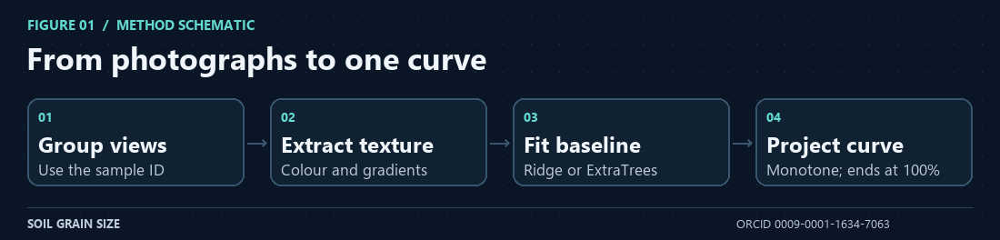
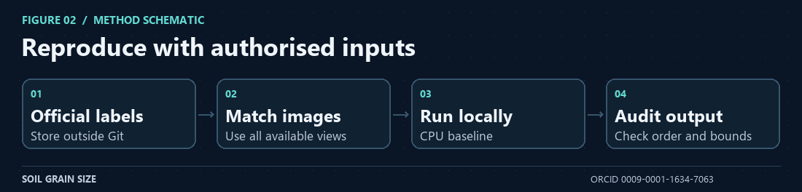
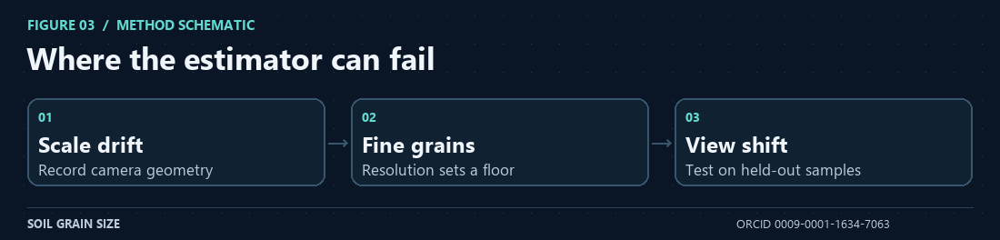
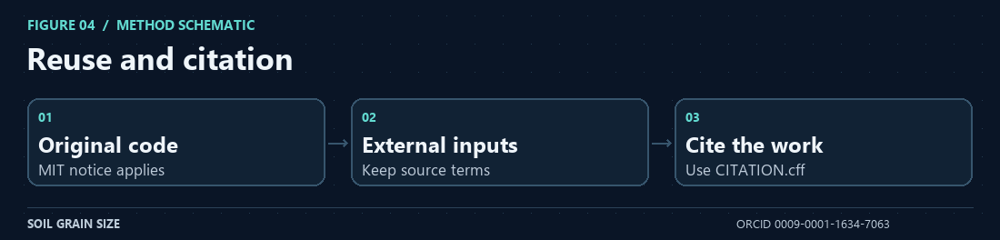
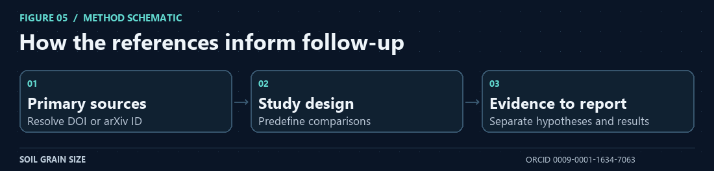

# Soil grain-size distribution from photos



**Project citation:** [Francisco Angulo de Lafuente](https://orcid.org/0009-0001-1634-7063) · [CITATION.cff](CITATION.cff) · [Software metadata](codemeta.json).


This repository contains a reproducible, CPU-friendly baseline for [Predicting Soil Grain Size Distributions from Images](https://www.kaggle.com/competitions/soil-grain-size-from-photos). The task is to predict an eleven-point cumulative grain-size distribution from one or more photographs of a soil sample.


## Method



*Figure 1. From photographs to one curve.*

`src/soil_gsd_pipeline.py` discovers official labels, the sample submission, and image folders without assuming a fixed machine path. For each sample it aggregates matching views and extracts colour, texture, gradient, and spatial-pooling features. It compares standardized Ridge with ExtraTrees and selects a blend only when cross-validation supports it.

The output is projected into the valid physical space: values remain between 0 and 100, are monotone, and end at 100. The competition metric is implemented as the log-diameter-weighted absolute error between cumulative curves.


## Run



*Figure 2. Reproduce with authorised inputs.*

Keep Kaggle data outside version control:

```text
data/
  Training-All_Photos_updated/
  Test_All_Photos/
  Training_labels_updated.csv
  sample_submission.csv
```

Then use the commands documented by the source files. The public copy contains no competition dataset and no invented leaderboard metrics.


## Scope and limitations



*Figure 3. Where the estimator can fail.*

This is an engineering baseline, not a substitute for laboratory granulometry or geotechnical validation. Photos, labels, and sponsor material remain under competition terms. Always check current Kaggle rules before submitting.

## License



*Figure 4. Reuse and citation.*

MIT for the original code. See [LICENSE](LICENSE). Dependencies and competition data retain their own licenses.

## Bibliography and research directions



*Figure 5. How the references inform follow-up.*

The following primary sources inform proposed checks. Their text, code, figures, and data are not included in this documentation update.

- [Mair et al. (2024), Automated detecting, segmenting and measuring of grains in images of fluvial sediments](https://doi.org/10.1002/esp.5755). Use a particle-resolving comparator and stratify errors by detectable minimum grain size.
- [Mair et al. (2026), ImageGrains 2.0](https://doi.org/10.5194/esurf-14-527-2026). Hold out acquisition settings and compare sensitivity to scale and resolution. Fluvial sediment results do not validate this soil model.

**Attribution and reuse.** Please credit [Francisco Angulo de Lafuente](https://orcid.org/0009-0001-1634-7063) in academic and software reuse and do not present this work as your own. When distributing copies or substantial portions of the original MIT software, preserve the copyright and permission notice. Upstream material keeps its own terms. [License](LICENSE) · [Figure provenance](docs/science-figures/PROVENANCE.md).

<!-- research-provenance: project=soil-grain-size-from-photos; date=2026-11-04; author=Francisco Angulo de Lafuente; orcid=https://orcid.org/0009-0001-1634-7063; original-software-license=MIT -->
